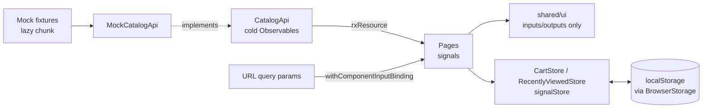

# Mocking momoshop

An Angular recreation of the core pages of the [momoshop](https://www.momoshop.com.tw) desktop site, built as a frontend take-home exercise.

> **Not affiliated with momoshop.** This is an interview project. Every product, price and campaign is generated mock data, and the app makes no calls to any real momo API.

Design notes, decisions and the full human-agent collaboration log are in [`docs/`](docs/) (written in Traditional Chinese).

## Getting started

Requires Node `^22.22.3 || ^24.15.0 || >=26`.

```bash
npm install     # also installs the husky git hooks
npm start       # http://localhost:4200
npm run lint
npm test -- --watch=false
npm run build
```

Append `?mockError=1` to any URL to make every mock request fail and see the error states.

## What's implemented vs. the real site

| Area                                             | Real momoshop                                                                    | This project                                                                             |
| ------------------------------------------------ | -------------------------------------------------------------------------------- | ---------------------------------------------------------------------------------------- |
| Utility bar                                      | Links, cart count, pinned while scrolling                                        | ✅ Pinned; cart count is live. Member/order links are static text                        |
| Header                                           | Logo, search, hot keywords, promo badges                                         | ✅ Search syncs with the URL keyword. Logo is a CSS approximation, not the real asset    |
| Category tabs                                    | Top-level categories                                                             | ✅ Loaded from the catalog API, active tab follows the URL                               |
| Home: hero + "今日大牌"                          | Multi-slide carousel with a brand grid                                           | ✅                                                                                       |
| Home: quick entries, promo banner, product rails | CMS-driven sections                                                              | ✅ Driven by a layout config (ADR 0004)                                                  |
| Home: "為你推薦" wall                            | Infinite scroll, then a "看更多" button                                          | ✅ Same rhythm: 1 batch + 2 auto-loads per round; disabled "已經沒有新商品了" at the end |
| Product card                                     | Promo line, 【brand】 name, price, rating, fast-delivery badge, tags, sold count | ✅ Single image (no per-card image carousel)                                             |
| Product page `/goods/:id`                        | Gallery, price, specs, quantity, add to cart                                     | ✅ Add to cart requires every spec group. "直接購買" explains checkout is out of scope   |
| Search `/search`                                 | Keyword/category results, sort, pagination                                       | ✅ Fully URL-driven, shareable, numeric pagination                                       |
| Floating sidebar                                 | Recently viewed, cart, sign-in reward, TOP                                       | ✅ Recently viewed (3), cart, TOP. Sign-in reward omitted on purpose                     |
| Cart `/cart`                                     | Cart and checkout flow                                                           | ⚠️ Cart list with quantity/remove/total. No checkout                                     |
| Images                                           | Real product photos                                                              | ⚠️ Local SVG placeholders (ADR 0005)                                                     |
| `/live`, `/discover`, login, member center       | Yes                                                                              | ❌ Out of scope                                                                          |
| Mobile                                           | Separate m-site                                                                  | ❌ Desktop only, fixed 1200px like the real desktop site                                 |

## Architecture

```
src/app/
├─ core/          layout (utility bar, header, category nav, floating sidebar, footer), routing helpers
├─ data-access/   models, CatalogApi + MockCatalogApi, search logic, signal stores, storage
├─ features/      home · goods · search · cart   (each a lazy route)
└─ shared/ui/     stateless components: product card, price, carousel, load error, in-viewport
src/mocks/        seeded fixture generator, SVG placeholders, home layout
```

Dependencies only point downward (`features → shared/ui, data-access`), and **ESLint enforces it**: a feature importing another feature, or anything outside `data-access` importing mock fixtures, fails lint and therefore the pre-commit hook.



- **Data boundary.** Pages depend only on the abstract `CatalogApi`. The mock simulates 200–400 ms latency and failures, so loading and error states are real code paths. Swapping in an HTTP implementation is a one-line provider change.
- **Observables at the boundary, signals everywhere else.** `rxResource()` is the single conversion point. RxJS earns its place where composition matters, e.g. `exhaustMap` in the recommendation wall prevents duplicate loads.
- **The URL is the state for search.** Refresh, back/forward and shared links always reproduce the same results.
- **Rendering.** Every route is lazy, the fixtures ship as their own chunk, and home sections below the fold use `@defer (on viewport)`. Browser APIs are only touched after render or behind services, so the app stays SSR-ready. Initial transfer is about 86 kB.

## Key decisions

| ADR                                                             | Decision                                                                                            |
| --------------------------------------------------------------- | --------------------------------------------------------------------------------------------------- |
| [0001](docs/decisions/0001-material-behavior-only.md)           | Use Angular Material for behaviour (snackbar, theming tokens), hand-written SCSS for brand-heavy UI |
| [0002](docs/decisions/0002-url-as-search-state.md)              | Search criteria live only in the URL                                                                |
| [0003](docs/decisions/0003-catalog-api-boundary.md)             | `CatalogApi` abstraction as the data boundary                                                       |
| [0004](docs/decisions/0004-section-driven-home.md)              | Home page rendered from a CMS-like section config                                                   |
| [0005](docs/decisions/0005-svg-placeholder-images.md)           | Local SVG placeholders instead of external images                                                   |
| [0006](docs/decisions/0006-agents-md-single-source.md)          | `AGENTS.md` as the single source of agent guidelines                                                |
| [0007](docs/decisions/0007-observable-boundary-signal-state.md) | Observables at the data boundary, signals for state                                                 |

## Quality gates

- **ESLint** (angular-eslint) with architecture boundaries, `prefer-signals` and `prefer-control-flow` as errors.
- **husky + lint-staged** run Prettier and ESLint on every commit.
- **69 Vitest tests in 18 files**, focused on logic and key interactions rather than coverage:

| Area        | Tests | What they cover                                                                                                                         |
| ----------- | ----- | --------------------------------------------------------------------------------------------------------------------------------------- |
| data-access | 25    | Search matching/sorting/paging, mock API errors and paging, cart merging/clamping/persistence, viewing history                          |
| mocks       | 4     | Deterministic generation, referential integrity of the home layout                                                                      |
| shared/ui   | 6     | Discount and sold-count copy, product card details                                                                                      |
| core        | 8     | Header search navigation, category tabs, floating sidebar, app shell                                                                    |
| features    | 26    | Deferred home sections, the load-more rhythm, spec gating and add-to-cart, not-found handling, URL parsing and pagination, cart editing |

## Working with AI agents

This project was built with Claude as a pair, and the process is part of the deliverable.

- **One rulebook.** [`AGENTS.md`](AGENTS.md) holds every convention; `CLAUDE.md` only imports it, so any agent (Claude, Codex, Cursor, …) reads the same rules.
- **Rules as code.** Architecture rules from `AGENTS.md` are encoded as lint rules, so an agent that ignores the document still cannot commit a violation.
- **Human gate per step.** Before each step the agent describes files, approach and tests, and writes code only after an explicit "ok go". Each step ends with lint, tests and a build passing, then a separate commit with a `Co-Authored-By` trailer.
- **Honest log.** [`docs/agent-log.md`](docs/agent-log.md) records every round, including:
  - Agent mistakes caught by tests: reading `resource.value()` in an error state, a stray `\$` escape in an external template, and a wrong import path for defer-block testing.
  - Direction changes made by the human after observing the real site: the infinite-scroll wall and its exact rhythm, the pinned utility bar, the floating sidebar, and switching the data boundary from Promises to Observables.
  - Lessons fed back into `AGENTS.md`, e.g. "read `value()` only after `hasValue()`" and "OnPush is already the default in Angular 22".

## Deliberately out of scope / next steps

- **SSR + prerendering** for home and product pages (SEO, LCP). The code avoids direct browser globals to make this a configuration change.
- **`HttpCatalogApi`** against a BFF, with retry and caching.
- **Search suggestions** in the header (`debounceTime` + `switchMap`), and the compact search box that appears in the pinned bar on scroll.
- **Observability:** a global error handler, runtime validation of API payloads, impression/click tracking, Web Vitals reporting.
- **Playwright visual regression** against reference screenshots, to measure "difference from the real site" objectively.
- **Mobile layout**, checkout, member features, `/live` and `/discover`.
